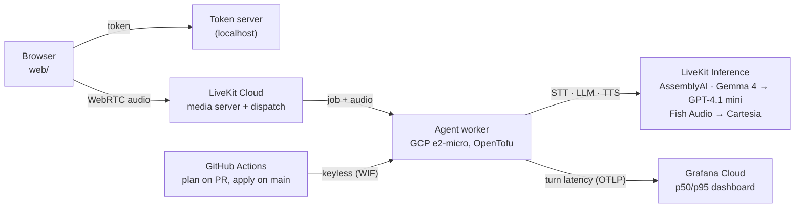

# mini-kulu-realtime

A small, working version of a realtime voice-agent path: browser ⇄ LiveKit (WebRTC) ⇄ Python agent
(STT → LLM → TTS), with per-stage latency metrics, resilience, and all infra in OpenTofu on GCP.

> Work in progress: the README's scale notes and the migration plan come next. Status below.

## Architecture



The agent only dials out (no public ports), each model has a backup from another vendor, and
every turn's latency per stage goes to one OpenTelemetry histogram. Full diagrams (a voice turn
mapped to its metrics, failure handling, the deploy pipeline): [docs/architecture.md](docs/architecture.md).

## Demo

| A call from the browser | LiveKit's own view of a session |
|---|---|
|  |  |

Left: the web client during a call with the deployed agent (prompts played into a fake mic). Right:
LiveKit Cloud's agent insights for the first cloud run, which measures the same stages
independently of this project's metrics. All sessions: [docs/img/livekit-sessions.png](docs/img/livekit-sessions.png).

The p50/p95 dashboard ([observability/dashboard.json](observability/dashboard.json)) on Grafana
Cloud, over the 30-turn run plus a forced voice failover (the Cartesia series and the 4 backup turns):

<picture>
  <source media="(prefers-color-scheme: dark)" srcset="docs/img/grafana-dashboard-dark.png">
  
</picture>

## Performance

Measured on GCP, agent-side, from the per-stage metric (raw data:
[docs/data/cloud-30-turns.jsonl](docs/data/cloud-30-turns.jsonl), write-up:
[docs/latency-results.md](docs/latency-results.md)).

<picture>
  <source media="(prefers-color-scheme: dark)" srcset="docs/img/turn-latency-over-call-dark.png">
  
</picture>

With CPU to spare, a turn takes **~0.96 s end to end** (p50): 0.36 s to decide the user is done,
0.19 s to the LLM's first token, 0.37 s to the first audio. Two minutes into a non-stop call, the
free shared-core e2-micro runs out of burst CPU, voice-activity detection falls behind real time,
and the p50 grows to 2.5 s. The metric and the agent's VAD warnings pinpoint it:

<picture>
  <source media="(prefers-color-scheme: dark)" srcset="docs/img/stage-latency-healthy-vs-starved-dark.png">
  
</picture>

Regenerate the charts: `uv run --no-project --with matplotlib python scripts/plot_latency.py docs/data/cloud-30-turns.jsonl`.

## Layout

```
agent/          LiveKit Agents worker (Python, asyncio), token server, synthetic caller, tests
web/            minimal browser client (LiveKit JS, no build step)
infra/          OpenTofu: bootstrap (state, budget, CI identities) + the agent VM, secrets, network
observability/  Grafana dashboard JSON + metric definitions
scripts/        web client start/stop, OpenTofu env helper, chart rendering
docs/           architecture, latency results, screenshots, the browser client guide
.github/        CI (tests, tofu validate, secret scan) and infra plan/apply
```

## Deploy

Everything runs on GCP's free tier and LiveKit's free plan. Steps, costs and CI setup:
[infra/README.md](infra/README.md). In short: `infra/bootstrap` once by hand, then `infra` from
GitHub Actions: a pull request shows the plan, merging to `main` applies it, and an agent code
change replaces the VM with the new release.

## Run it locally

Requires [uv](https://docs.astral.sh/uv/) and a LiveKit Cloud project.

```bash
cd agent
cp .env.example .env.local   # fill in LIVEKIT_URL / LIVEKIT_API_KEY / LIVEKIT_API_SECRET
uv sync
uv run python agent.py dev          # a local agent worker; wait for "registered worker"
```

Talk to it (or to the deployed agent) from a browser:

```bash
scripts/web-client.sh start safari  # token endpoint + page on http://localhost:8080
scripts/web-client.sh stop
```

Click **Start call** and talk. The page gets a token from `POST /api/token` (LiveKit's standard
token-endpoint format), and the token dispatches the `mini-kulu` agent into a fresh room. Reloading
the page rejoins the same room and the agent carries on with the same conversation (it waits
`AGENT_REJOIN_GRACE_S`, 30 s); **Hang up** ends the agent's session at once over RPC. More:
[docs/local-web-client.md](docs/local-web-client.md).

## Resilience

| Failure | Behaviour |
|---|---|
| LLM late or stalled (no bytes for 3 s) | GPT-4.1 mini takes the same turn; probes switch back to Gemma when it recovers |
| Both LLMs down | the agent says it lost its train of thought instead of going silent |
| TTS error or no audio for 5 s | Cartesia speaks the sentence instead of Fish Audio |
| Browser refresh, network drop | the session waits 30 s; rejoining continues the conversation |

Try the failover: `AGENT_LLM_MODELS=openai/does-not-exist,google/gemma-4-31b-it` or
`AGENT_TTS_VOICES=fishaudio/does-not-exist:x,cartesia/sonic-3:9626c31c-bec5-4cca-baa8-f8ba9e84c8bc`
on a local agent; the backup answers and the dashboard shows the second model.

## Test without a microphone

`agent/synthetic_caller.py` joins over WebRTC like a browser, speaks prompts rendered with macOS
`say`, and measures each turn from the end of its speech to the first audible reply.

```bash
cd agent
uv run python synthetic_caller.py --turns 10 --out results.jsonl   # p50/p95 turn latency
uv run python synthetic_caller.py --scenario rejoin --away 25       # leave, rejoin, check memory
uv run pytest -q && uv run ruff check .
```

Run a local agent with `AGENT_NOISE_CANCELLATION=0` for these test runs: noise cancellation is
meant for real microphones, costs CPU, and counts against LiveKit's monthly noise-cancellation
minutes.

## Latency metrics

The agent records each turn's latency per stage (`stt_final`, `end_of_turn`, `llm_ttft`, `tts_ttfb`,
`e2e`) in an OpenTelemetry histogram and pushes it over OTLP when `OTEL_EXPORTER_OTLP_ENDPOINT` is
set (Grafana Cloud here); otherwise it logs one line per message. Metric definition, labels and
p50/p95 queries: [observability/README.md](observability/README.md).

## Status

- [x] Day 1: LiveKit quickstart agent running locally ([screenshot](docs/day1-console.png))
- [x] Day 2: own browser client + token endpoint, refresh rejoins the same conversation
- [x] Day 3: per-stage turn latency → OpenTelemetry histogram, pushed over OTLP
- [x] Day 4: OpenTofu on GCP (free tier), remote state, write-only secrets, budget alert
- [x] Day 5: CI (tests, tofu validate, secret scan), keyless plan/apply, deployed
- [x] Day 6: Grafana p50/p95 dashboard; LLM watchdog + backup model; TTS fallback
- [ ] Day 7: scale notes, migration plan, video

## Roadmap (next)

- **ElevenLabs mode, switchable.** An env toggle (e.g. `AGENT_TTS_PROVIDER=elevenlabs`) that puts
  ElevenLabs (`eleven_flash_v2_5` or v4 Turbo, own API key) first in the voice chain, with the
  LiveKit Inference voices as the fallback; off by default, so the stack keeps working with
  only LiveKit credentials. Notes: [docs/elevenlabs-integration.md](docs/elevenlabs-integration.md).
- **A cleaner client UI.** A minimal call screen: one microphone button (mute/unmute, call
  state), a live voice waveform for the user and the agent (Web Audio analyser on the local and
  remote tracks), and a modern transcript (speaker labels, timestamps, interim text streaming
  in, consecutive user segments merged into one bubble). Still a single static page, no build.
- **Hosted client on Cloud Run, behind a passcode.** The token server and page as a
  scale-to-zero Cloud Run service in OpenTofu (slim image built in CI, free tier), with a
  passcode gate on `/api/token` (passcode in Secret Manager, signed session cookie) and a
  per-IP rate limit, so a public link can't spend the LiveKit inference credit.
