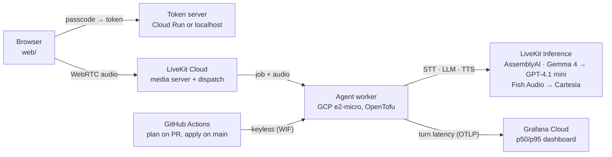
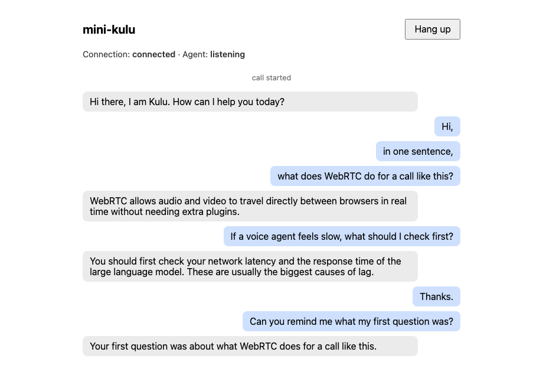
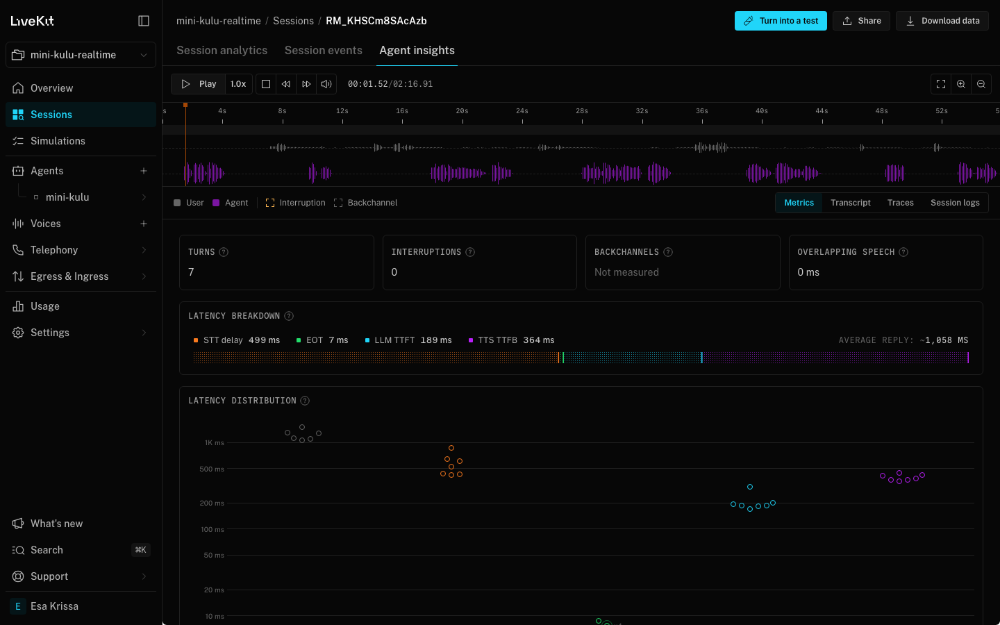
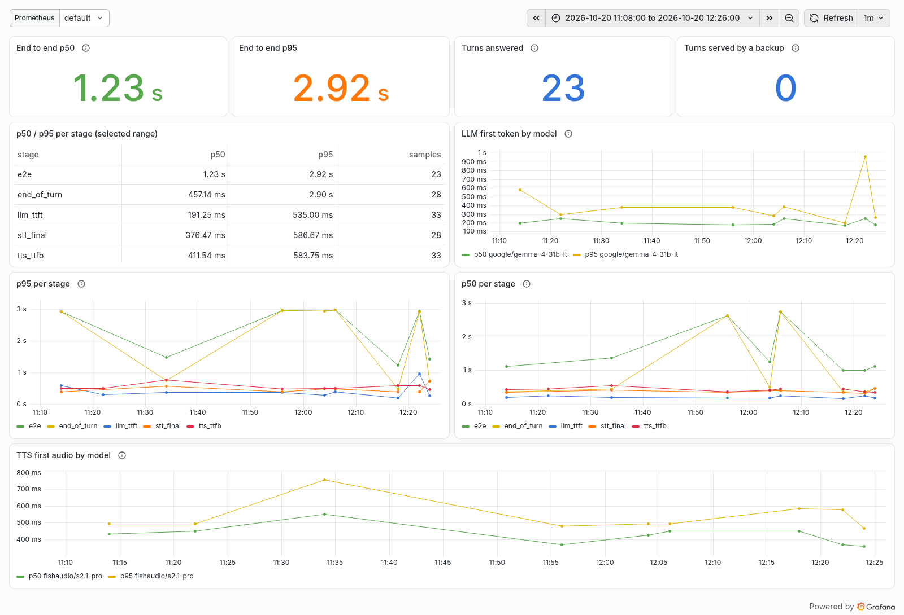
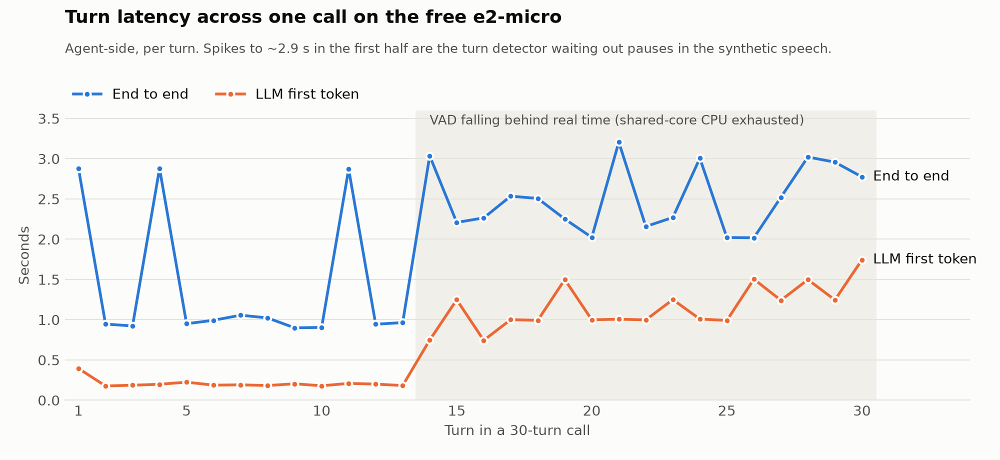
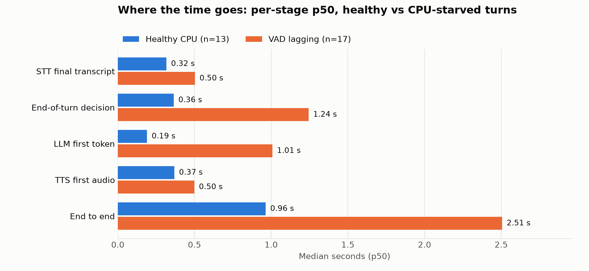

# mini-kulu-realtime

A small, working version of a realtime voice-agent path: browser ⇄ LiveKit (WebRTC) ⇄ Python agent
(STT → LLM → TTS), with per-stage latency metrics, resilience, and all infra in OpenTofu on GCP.

## Architecture



The agent only dials out (no public ports), each model has a backup from another vendor, and
every turn's latency per stage goes to one OpenTelemetry histogram. Full diagrams (a voice turn
mapped to its metrics, failure handling, the deploy pipeline): [docs/architecture.md](docs/architecture.md).

## Demo

| A call from the browser | LiveKit's own view of a session |
|---|---|
|  |  |

Left: the web client during a call with the deployed agent (prompts played into a fake mic). Right:
LiveKit Cloud's agent insights for the first cloud run, which measures the same stages
independently of this project's metrics. All sessions: [docs/img/livekit-sessions.png](docs/img/livekit-sessions.png).

The p50/p95 dashboard ([observability/dashboard.json](observability/dashboard.json)) on Grafana
Cloud, over the 30-turn run plus a forced voice failover (the Cartesia series and the 4 backup turns):

<picture>
  <source media="(prefers-color-scheme: dark)" srcset="docs/img/grafana-dashboard-dark.png">
  
</picture>

## Performance

Measured on GCP, agent-side, from the per-stage metric (raw data:
[docs/data/cloud-30-turns.jsonl](docs/data/cloud-30-turns.jsonl), write-up:
[docs/latency-results.md](docs/latency-results.md)).

<picture>
  <source media="(prefers-color-scheme: dark)" srcset="docs/img/turn-latency-over-call-dark.png">
  
</picture>

With CPU to spare, a turn takes **~0.96 s end to end** (p50): 0.36 s to decide the user is done,
0.19 s to the LLM's first token, 0.37 s to the first audio. Two minutes into a non-stop call, the
free shared-core e2-micro runs out of burst CPU, voice-activity detection falls behind real time,
and the p50 grows to 2.5 s. The metric and the agent's VAD warnings pinpoint it:

<picture>
  <source media="(prefers-color-scheme: dark)" srcset="docs/img/stage-latency-healthy-vs-starved-dark.png">
  
</picture>

Regenerate the charts: `uv run --no-project --with matplotlib python scripts/plot_latency.py docs/data/cloud-30-turns.jsonl`.

## What I'd do at Kulu's scale

This repo runs one worker on a free VM. Running many concurrent calls for enterprise customers
changes five things:

- **Workers next to the media.** Run agent pools in several regions, each next to the LiveKit
  SFU region it serves (us-central1 ↔ "US Central" here), and let LiveKit dispatch to the
  nearest one. Every hop between the SFU and the worker is paid twice per turn (audio in, audio
  out), and the inference endpoints should be in the same region too.
- **TURN for enterprise networks.** Corporate firewalls often block UDP and anything but 443.
  LiveKit Cloud includes TURN over TLS on 443; self-hosted, run TURN/TLS on 443 behind its own
  domain, and track the share of calls that fall back to TURN (it adds latency and egress).
- **SLOs on what the caller feels.** SLO: e2e turn latency p95 < 1.5 s and < 1% of turns served
  by a backup model, per region, over 28 days. Alert on the burn rate, not on single slow turns.
  Add leading indicators from this repo's findings: the VAD "slower than realtime" warning and
  event-loop stalls fire minutes before p95 moves, so they page first.
- **Size workers on CPU per concurrent call.** The 30-turn run showed the failure mode: a
  starved CPU makes voice-activity detection fall behind and e2e goes from ~1 s to ~2.5 s with
  no error anywhere. Measure CPU per concurrent call under load (noise cancellation on, since it
  costs the most), set each worker's `load_fnc`/`load_threshold` so LiveKit stops dispatching
  before that point, and autoscale the pool on worker load instead of request count.
- **Cost per call minute, as a dashboard.** STT + LLM tokens + TTS characters + agent CPU-minutes
  + TURN egress, per minute of call. Most of it is inference, so the levers are model choice,
  caching the system prompt, and cutting wasted generations (interruptions, false end-of-turn).
  Backup models only bill when they serve a turn, so resilience is close to free.

The AWS → GCP move itself (parallel run, database cutover, DNS, rollback) is in
[docs/migration-plan.md](docs/migration-plan.md).

## Layout

```
agent/          LiveKit Agents worker (Python, asyncio), token server, synthetic caller, tests
web/            minimal browser client (LiveKit JS, no build step)
infra/          OpenTofu: bootstrap (state, budget, CI identities) + the agent VM, secrets, network
observability/  Grafana dashboard JSON + metric definitions
scripts/        web client start/stop, OpenTofu env helper, chart rendering
docs/           architecture, latency results, screenshots, the browser client guide
.github/        CI (tests, tofu validate, secret scan) and infra plan/apply
```

## Deploy

Everything runs on GCP's free tier and LiveKit's free plan. Steps, costs and CI setup:
[infra/README.md](infra/README.md). In short: `infra/bootstrap` once by hand, then `infra` from
GitHub Actions: a pull request shows the plan, merging to `main` applies it, and an agent code
change replaces the VM with the new release.

## Run it locally

Requires [uv](https://docs.astral.sh/uv/) and a LiveKit Cloud project.

```bash
cd agent
cp .env.example .env.local   # fill in LIVEKIT_URL / LIVEKIT_API_KEY / LIVEKIT_API_SECRET
uv sync
uv run python agent.py dev          # a local agent worker; wait for "registered worker"
```

Talk to it (or to the deployed agent) from a browser:

```bash
scripts/web-client.sh start safari  # token endpoint + page on http://localhost:8080
scripts/web-client.sh stop
```

Click **Start call** and talk. The page gets a token from `POST /api/token` (LiveKit's standard
token-endpoint format), and the token dispatches the `mini-kulu` agent into a fresh room. Reloading
the page rejoins the same room and the agent carries on with the same conversation (it waits
`AGENT_REJOIN_GRACE_S`, 30 s); **Hang up** ends the agent's session at once over RPC. More:
[docs/local-web-client.md](docs/local-web-client.md).

## Resilience

| Failure | Behaviour |
|---|---|
| LLM late or stalled (no bytes for 3 s) | GPT-4.1 mini takes the same turn; probes switch back to Gemma when it recovers |
| Both LLMs down | the agent says it lost its train of thought instead of going silent |
| TTS error or no audio for 5 s | Cartesia speaks the sentence instead of Fish Audio |
| Browser refresh, network drop | the session waits 30 s; rejoining continues the conversation |

Try the failover: `AGENT_LLM_MODELS=openai/does-not-exist,google/gemma-4-31b-it` or
`AGENT_TTS_VOICES=fishaudio/does-not-exist:x,cartesia/sonic-3:9626c31c-bec5-4cca-baa8-f8ba9e84c8bc`
on a local agent; the backup answers and the dashboard shows the second model.

**ElevenLabs mode (optional).** `AGENT_TTS_PROVIDER=elevenlabs` with your own `ELEVEN_API_KEY`
puts an ElevenLabs voice (`eleven_flash_v2_5`, `ELEVEN_VOICE_ID` to pick one) at the front of the
voice chain; Fish Audio and Cartesia stay behind it as the fallback, so a bad key or an
ElevenLabs outage costs one sentence, not the call. It's off by default, and without a key the
agent logs a warning and stays on LiveKit Inference. On GCP: set the repository variable
`TTS_PROVIDER=elevenlabs` and the secret `ELEVEN_API_KEY`, then re-run the Infra workflow.

## Test without a microphone

`agent/synthetic_caller.py` joins over WebRTC like a browser, speaks prompts rendered with macOS
`say`, and measures each turn from the end of its speech to the first audible reply.

```bash
cd agent
uv run python synthetic_caller.py --turns 10 --out results.jsonl   # p50/p95 turn latency
uv run python synthetic_caller.py --scenario rejoin --away 25       # leave, rejoin, check memory
uv run pytest -q && uv run ruff check .
```

Run a local agent with `AGENT_NOISE_CANCELLATION=0` for these test runs: noise cancellation is
meant for real microphones, costs CPU, and counts against LiveKit's monthly noise-cancellation
minutes.

## Latency metrics

The agent records each turn's latency per stage (`stt_final`, `end_of_turn`, `llm_ttft`, `tts_ttfb`,
`e2e`) in an OpenTelemetry histogram and pushes it over OTLP when `OTEL_EXPORTER_OTLP_ENDPOINT` is
set (Grafana Cloud here); otherwise it logs one line per message. Metric definition, labels and
p50/p95 queries: [observability/README.md](observability/README.md).

## Status

- [x] Day 1: LiveKit quickstart agent running locally ([screenshot](docs/day1-console.png))
- [x] Day 2: own browser client + token endpoint, refresh rejoins the same conversation
- [x] Day 3: per-stage turn latency → OpenTelemetry histogram, pushed over OTLP
- [x] Day 4: OpenTofu on GCP (free tier), remote state, write-only secrets, budget alert
- [x] Day 5: CI (tests, tofu validate, secret scan), keyless plan/apply, deployed
- [x] Day 6: Grafana p50/p95 dashboard; LLM watchdog + backup model; TTS fallback
- [x] Day 7: scale notes, [migration plan](docs/migration-plan.md), [demo script](docs/demo-script.md)

## Roadmap

- [x] **ElevenLabs mode, switchable** (see Resilience): an ElevenLabs voice in front of the
  Inference voices, off by default. Notes: [docs/elevenlabs-integration.md](docs/elevenlabs-integration.md).
- [x] **A cleaner client UI**: a call card with a phone button (start / hang up) and a mic
  button (mute), a live waveform from Web Audio analysers on both tracks (green while the agent
  speaks, a sweep while it thinks), the agent's words streaming in as it says them (live caption
  + transcript), consecutive user segments merged into one bubble, and the reply latency the
  page sees on each answer. Still one static page, no build step.
- [x] **Hosted client on Cloud Run, behind a passcode**: the token server and page as a
  scale-to-zero Cloud Run service in OpenTofu (slim image built and pushed by CI, free tier), a
  passcode gate on `/api/token` (passcode in Secret Manager, signed HttpOnly session cookie), per-IP
  rate limits and a daily call cap, and an optional custom domain. Setup:
  [infra/README.md](infra/README.md#hosted-web-client-cloud-run).

Next:

- [ ] **Agent tools: live web search through Exa's MCP server.** Give the agent a
  `web_search_exa` tool from Exa's hosted MCP server (`https://mcp.exa.ai/mcp`, API key in
  the `x-api-key` header from Secret Manager), attached with LiveKit's
  `mcp.MCPToolset(mcp_server=mcp.MCPServerHTTP(..., allowed_tools=["web_search_exa"]))` so the
  model sees one tool, not Exa's whole surface. Exa 3.0 (19 Oct 2026) serves it: a larger
  embedding model, Dynamic Highlights (about 95% fewer tokens than full pages, which keeps the
  LLM's first token fast), and a $4 per 1,000 requests Lite tier next to Auto at $7. For voice:
  the agent says a short filler ("let me look that up") while the tool runs, the tool call gets
  its own stage in the latency histogram (`tool_call`), and a search that takes longer than ~3 s
  is dropped, so the answer comes without it rather than late.
- [ ] **"Ask about this project": an MCP server that can only see this repository.** Let the
  agent explain mini-kulu itself (architecture, why an e2-micro, how the failover works) from
  the code, not from memory. Plan: [GitMCP](https://github.com/idosal/git-mcp)'s per-repo
  endpoint, `https://gitmcp.io/esakrissa/mini-kulu-real-time`. The repository is fixed by the
  URL, so the tools (fetch docs, search docs, search code) can't reach any other repo. It's
  free, needs no token, and reads a `llms.txt` first, so the repo gets a short `llms.txt` that
  points at the README, `docs/architecture.md` and the key modules. Alternatives considered:
  the official GitHub MCP server with a fine-grained token limited to this one repository,
  read-only, `repos` toolset only (tightest access control, but raw file reads cost more tokens
  and time per turn); DeepWiki's MCP `ask_question` (good answers, but slow for voice, and its
  tools take any repository name, so it needs a wrapper that pins the name).
