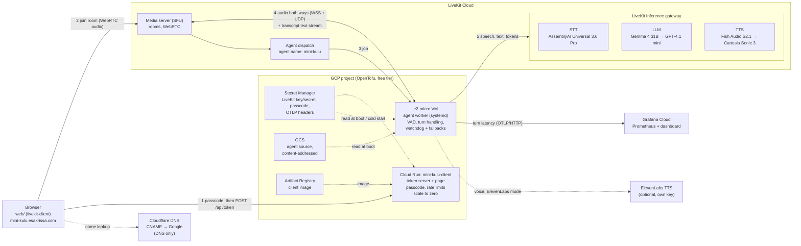
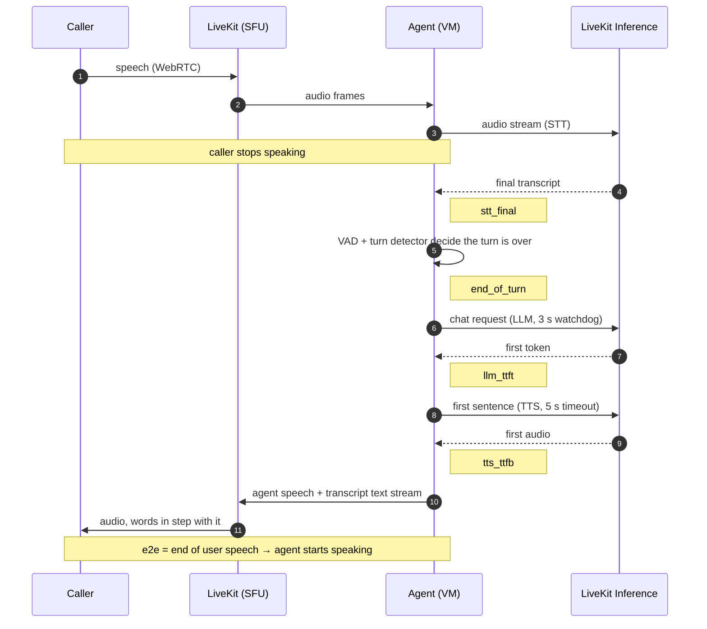
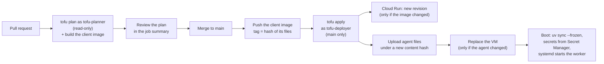

# Architecture

## System

- **The VM only dials out.** It registers with LiveKit as a worker for `mini-kulu`, then
  waits for jobs; nothing listens on a public port (SSH goes through Identity-Aware Proxy).
- **The browser never talks to the agent directly.** Its audio goes to LiveKit's media
  server; the agent joins the same room as another participant.
- **The token server is the only place the LiveKit secret meets the browser path.** It signs
  a short-lived token for one random room that also dispatches the agent. Hosted, it runs on
  Cloud Run behind a passcode (traded for a signed, HttpOnly session cookie) with per-IP rate
  limits and a daily cap on new calls (`agent/access.py`); the same server runs on localhost
  for development. It's out of the call path once the browser has joined.
- **The page shows the call as it happens.** Waveforms come from Web Audio analysers on both
  audio tracks; the agent's words arrive as a LiveKit text stream synchronized with its
  speech, so the transcript and live caption fill in word by word.
- **Models run behind LiveKit Inference**: one credential, swappable providers. Each of LLM
  and TTS has a backup from a different vendor (`agent/llm_watchdog.py`,
  `agent/tts_fallback.py`). ElevenLabs mode (off by default, own key) puts an ElevenLabs
  voice in front of the Inference voices.

## One voice turn, and what each metric measures

Every stage lands in one OpenTelemetry histogram, `mini_kulu.turn.stage_latency`, with
`stage` and `model` labels ([observability/README.md](../observability/README.md)), so a
failover shows up on the dashboard as a second model.

## Failure handling

| Failure | What happens | Where |
|---|---|---|
| LLM slow or stalled (no bytes for 3 s) | backup model takes the same turn; background probes switch back when the primary recovers | `agent/llm_watchdog.py` |
| Both LLMs fail | the agent apologizes instead of going silent; the session ends after 3 failed turns in a row | `agent/llm_watchdog.py` |
| TTS errors or no audio for 5 s | backup voice speaks the sentence | `agent/tts_fallback.py` |
| Browser refresh or network drop | agent keeps the session 30 s; rejoining with the same identity continues the conversation | `agent/rejoin.py` |
| Web search or repo read slow or failing (MCP) | the tool returns one sentence after 4 s at most and the agent answers without it; the next call reconnects | `agent/agent_tools.py` |
| VM reboot | systemd restarts the worker; the startup script reinstalls from the pinned release | `infra/startup.sh.tftpl` |
| Microphone blocked or missing | the call stays up; the mic button offers a retry | `web/app.js` |
| Public link abused | passcode required for tokens; per-IP limits (401/429) and 100 new calls a day | `agent/access.py` |

## Deploys

GitHub Actions authenticates with Workload Identity Federation: no service account keys
exist. The LiveKit key and secret are ephemeral OpenTofu variables passed through write-only
arguments, so they never appear in a plan or in the state ([infra/README.md](../infra/README.md)).
The custom domain is a Cloud Run domain mapping in OpenTofu; Google issues and renews its
certificate, which is why the Cloudflare record stays DNS only.
